# 4 RESULTS AND DISCUSSION

> **TEAM NOTE (delete every TEAM NOTE block before pasting into the manuscript).**
> **Cut to the course guide on 12 October 2026** (*Capstone Project 2 Student Guide, Chapter 4*, v03:
> 25 to 45 pages, "padding is penalized"; indicator-level tables, full test cases and raw data in the
> Appendices). The full text of 11 October is commit `a7ce1e9`; nothing in it was deleted that is not
> either condensed here or moved word for word to `APPENDIX_M_CHAPTER_4_EVIDENCE.md`: the walkthrough
> rows (old Table 10), the survey items (old Tables 14 to 21), the measured evidence per
> characteristic (old Tables 14A to 21A) and every optimization (old Table 23, 51 rows). Table and
> figure numbers are the drafts' own; `TABLE_AND_FIGURE_NUMBERS.md` maps them to the chapter scheme
> (Table 4-1). Captions are in the guide's sentence case and sit above every exhibit (guide Part 8.1).
> Headings stay by objective: the guide calls the 4.1 to 4.4 headings strong advice, the template's
> own Chapter 4 is titled by objective, and the adviser decides (GUIDE_ALIGNMENT D1).

This chapter presents the results of the study in the order of the four specific objectives in
Section 1.2: the analysis of existing practices (4.1), the development of the system (4.2), pilot
testing (4.3), and evaluation and optimization against ISO/IEC 25010 (4.4), followed by the
deployment plan (4.5). Testing and evaluation follow one family of standards, ISO/IEC 25000 (SQuaRE),
as declared in Section 3.3: the quality model of ISO/IEC 25010:2011, its measures in the manner of
ISO/IEC 25023 and 25022, and the evaluation process of ISO/IEC 25040. Every quality characteristic is
judged on two kinds of evidence, what was measured in testing and how the system's users rated it.

---

## 4.1 Analysis of Existing Apartment Management Practices and System Requirements

*Answers Objective 1.*

The Fe Galang Da Silva Boarding House has 33 rentable units in five clusters: the Boarding House
(22 units), the Back Apartment (5), the Front Apartment (3), the Penthouse (1) and Linda (2), on three
residential floors and a rooftop penthouse level (11, 11, 10 and 1 units). At the time of writing, 32
of the 33 units are occupied. The owner confirmed these figures on 13 September 2026, and they are
checked against the live records on every verification run.

### 4.1.1 Existing Practices and Identified Problems

Before the system, the owner kept a spreadsheet workbook with two sheets, a Monthly Income Report and
a Monthly Expenses Report, on a USB flash drive, together with a paper invoice book. Rent was
collected in cash on site, and requests arrived by messaging application or in person. Table 5
compares each practice with the problem it caused. Inquiries arrived much as Pernate et al. (2025)
found for boarding houses in Ormoc City, through social media and word of mouth, and left no record.

**Table 5.** Existing practices and identified problems

| Area | Existing practice | Problem identified |
| :--- | :--- | :--- |
| Tenant management | Tenant details kept in the income sheet and in the owner's memory | No single record of who lives in which unit, since when, or how many occupants |
| Financial tracking | Income and expense sheets typed by hand; invoices written in a paper book | Totals depend on manual arithmetic; nothing checks an invoice number against the book; one file on a USB flash drive is the only copy |
| Communication | Requests sent by messaging application or said in person | Requests are not recorded, so there is no way to follow a request to completion |
| Booking | Inquiries arrived through Facebook, referrals from other people, contact and text messages, or walk-ins in person | No record of inquiries or which unit an inquiry was about |

Figure 4 follows each area through the hands that touched it. Every path ends in a record kept apart
from the others, or in no record at all, which is where each problem in Table 5 begins.

*Figure 4. The owner's process before the system.*

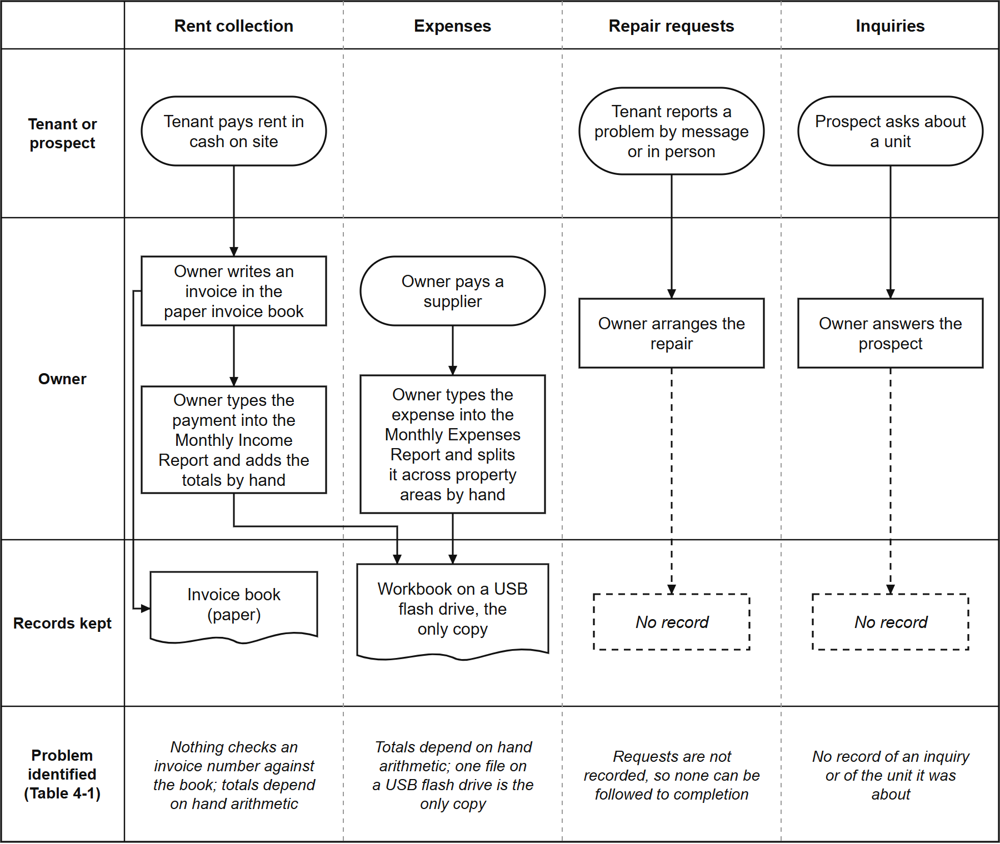

The strongest evidence came from the owner's own records. Transferring her workbook into the system
(937 income rows and 1,327 expense allocations) exposed problems the spreadsheet had hidden: **402 of
the 937 income rows (43%)** had no anniversary date and no deposit, and **five invoice numbers** were
each used for two different payments, once for two tenants on the same day. They were kept exactly as she wrote them and are reported on every verification run. The decisive
finding is that the problems did not sit in one area: **each area kept its own informal record, and nothing
connected one to another**, the fragmentation described in Chapter 2 (Burke, 2026; Magno et al., 2024).

### 4.1.2 System Requirements

The analysis produced **44 functional requirements** and **49 business rules**, each traced in a
traceability matrix to the part of the system that implements it. Graded against the
code on 16 September 2026, 25 of the 44 were implemented as worded, 15 in part, 1 in the interface
only, and 3 not as worded, although what those three describe is visible to the owner in another
form. Table 6 traces each gap to the requirement and the module that meets it.

**Table 6.** Identified gaps, system requirements and implementing modules

| Identified gap | System requirement | Module (Section) |
| :--- | :--- | :--- |
| No single tenant and unit record | Keep one record per unit and per tenant, with occupancy and move-in dates | Tenant and Room Management (4.2.2) |
| Inquiries not recorded | Let the public view units and send an inquiry about a specific unit | Booking and Reservation (4.2.3) |
| Manual arithmetic and unchecked receipts | Compute charges, record payments against the owner's own invoice numbers, reproduce the owner's reports | Financial Tracking (4.2.4) |
| Cash only, no digital option | Offer an optional online payment that the owner verifies before it counts | Financial Tracking (4.2.4) |
| Requests not followed to completion | Record each request and its status until the owner closes it | Maintenance Ticketing and Notification (4.2.5) |
| Anyone with the file sees everything | Give the owner and each tenant access to only what their role needs | Role-Based Access Control (4.2.6) |
| One file on one device | Make the system reachable from any phone or computer | Progressive Web Application (4.2.7) |

The analysis also set ten non-functional requirements, one for each ISO/IEC 25010 characteristic
and two for auditability and exportability. Table 6B lists them with the section that reports how
each was met.

**Table 6B.** Non-functional requirements and where each is measured

| Code | Requirement | Measured in |
| :--- | :--- | :--- |
| NFR-001 | The system shall provide the required business functions accurately | Sections 4.3.1 to 4.3.4; Section 4.4.3 |
| NFR-002 | The system shall be understandable to a non-technical administrator | Section 4.3.7; Section 4.4.3 (Usability) |
| NFR-003 | The system shall protect personal and financial information | Section 4.2.6; Section 4.4.4 |
| NFR-004 | Common operations should respond efficiently under the expected workload | Tables 11 and 11B |
| NFR-005 | The system shall function on modern desktop and mobile browsers | Table 24; Section 4.4.3 (Compatibility) |
| NFR-006 | The system shall preserve data consistency and avoid silent data loss | Sections 4.3.1, 4.3.3 and 4.3.6 (Table 11F) |
| NFR-007 | The codebase shall use a modular, documented, maintainable architecture | Section 4.4.3 (Maintainability): partly met |
| NFR-008 | The system shall be deployable to a hosting environment the team can maintain | Section 4.2.1; Table 24 |
| NFR-009 | Important financial and administrative changes shall be traceable | Section 4.2.6 (audit trail) |
| NFR-010 | Relevant business data shall be usable outside the application | Section 4.2.4 (Excel downloads) |

NFR-008 originally named the university's server; on the adviser's advice the team deployed the
system on its own hosting instead (Section 3.2.5), and the requirement was reworded to match.

Where a requirement needed the owner's answer, it was asked rather than assumed. She confirmed that
a bill is overdue from the day after its due date, that she sets rates by hand (so every rate change
is recorded and no increase is applied automatically), that a tenant needs no email address to be
recorded, and on 20 September 2026 the rate of every unit, each of which agreed with her receipts.
Her answers of 12 October 2026 settled the rest: the figure at the bottom of her income sheet is a
year-to-date total; her thirteen expense categories stay and she may add her own; tenants do not
report cash payments, because the administrators record every payment; the personal spending booked
in 2025 was a renovation of her house; past Penthouse spending stays where it was filed; and three
months with no receipt for one unit stay blank. Her workbook never recorded the move-in date of each
current tenancy, so the system shows those dates as not recorded (Section 4.2.2).

---

## 4.2 Development of the Hivelet System

*Answers Objective 2. Each feature the objective names has its own subsection.*

Figures 5 to 9 model the system as built, and Figures 10 to 14 show its screens as they stood on 5
October 2026. The units, rates and statuses in Figures 10 and 11 are the property's own; the names,
payments, expenses and repair requests in Figures 10, 12, 13 and 14 are sample records, so that no
real tenant's name or payment appears in any figure.

### 4.2.1 System Architecture and Technology Stack

The system was built in three Agile iterations (Section 3.2). The first (24 July to 28 August 2026)
built a working system and transferred the owner's records into it; the second (12 to 14 September)
checked the system and its documents against each other, corrected 22 recorded errors and added
automated checks; the third (15 September to the defense) took the owner's answers, put the system
in her and her tenants' hands, and refined it from their feedback, the testing and the evaluation.
Appendix M, Table M-19, sets out what each iteration did in each phase of Section 3.2. Each was tested
and reviewed by the means available to it; the formal evaluation against ISO/IEC 25010 was carried
out once, in the third, because Section 3.3 places it in actual use. Table 7 lists the technology
used.

**Table 7.** Technology stack of the developed system

| Layer | Technology | Purpose |
| :--- | :--- | :--- |
| Presentation | Vue 3.5 with TypeScript 5.7, built with Vite 5.4, styled with Tailwind CSS 4.0 | The screens used by the public, tenants and the owner |
| Application | Node.js with Express 4.19 in TypeScript | Business rules, calculations and access checks |
| Data | PostgreSQL 17.6, hosted on Supabase | Storage of all records, with row-level security |
| Payment gateway | Adyen (Web Drop-in 6.44, API Library 32.0) with GCash | The optional online payment |
| Client delivery | Progressive Web Application (vite-plugin-pwa) | Installation on a phone or computer without an app store |
| Hosting | Vercel | Serves the application at a public web address |

Figure 5 shows where each part runs. The application reaches the browser as a Progressive Web
Application and talks to one server program, an Express API on Vercel, which alone reads or writes
the database: row-level security is on for every table, so a request that does not pass the API's
sign-in and role checks reaches no data. Payment details go from Adyen's own form to Adyen directly,
and every change to the database is a numbered, reviewable migration.
The system is hosted rather than run on a server at the property or the university: on the adviser's
advice the team deployed it on its own hosting (Section 3.2.5), so the boarding house needs no
equipment beyond the owner's own laptop and phone.

*Figure 5. System architecture.*

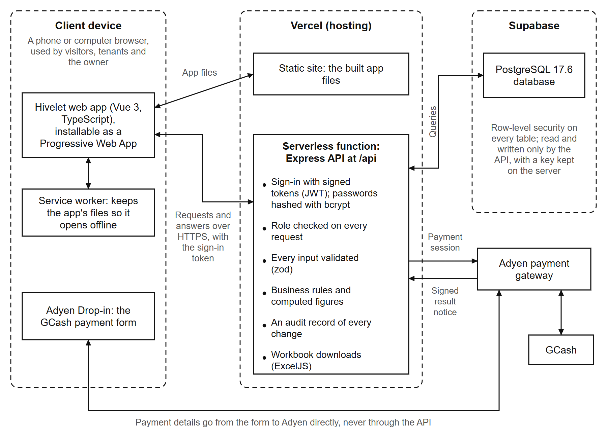

Figure 6 is the context diagram: the system as one process, with the four parties outside it and the
data that passes between them. Figure 7 opens it into eight processes and the stores each reads and
writes, in the Yourdon-DeMarco notation. To trace one path: the owner records a cash receipt through
process 4.0, Bill and record payments, which writes it to store D3, Bills and receipts, and process
7.0, Produce reports, reads it from there for the Overview and the Excel workbooks. The notifications
and the audit record are written by nearly every process and are left out of Figure 7 for
readability.

*Figure 6. Context diagram.*

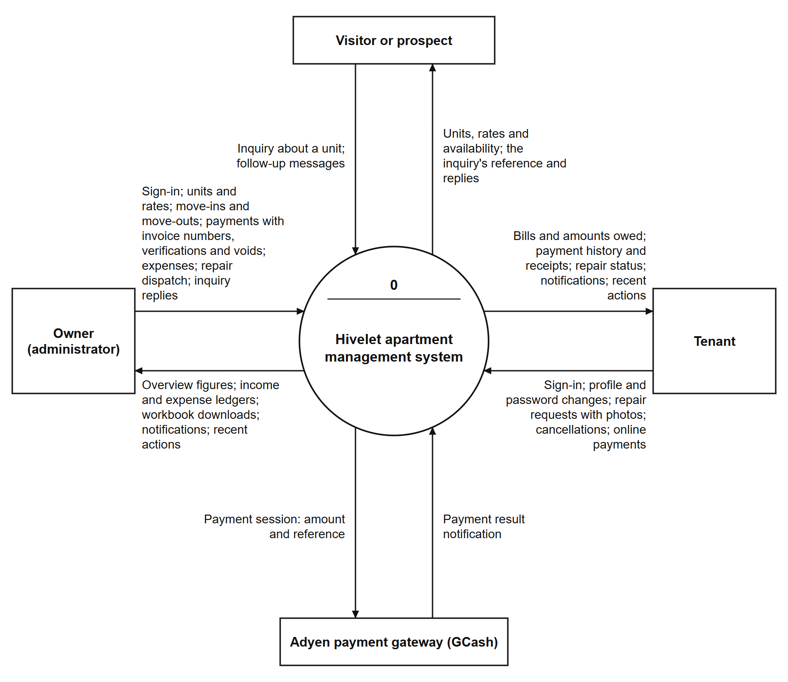

*Figure 7. Level 1 data flow diagram.*

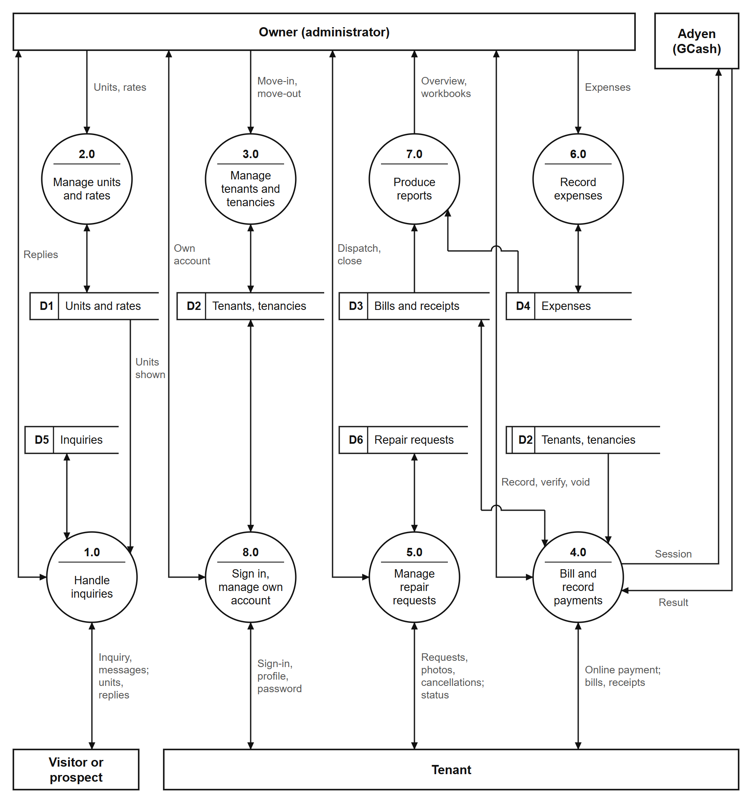

Figure 8 shows the same functions from the side of the people who use them. Each use case is a
function the server grants to that role and refuses to every other (Table 7C).

*Figure 8. Use case diagram.*

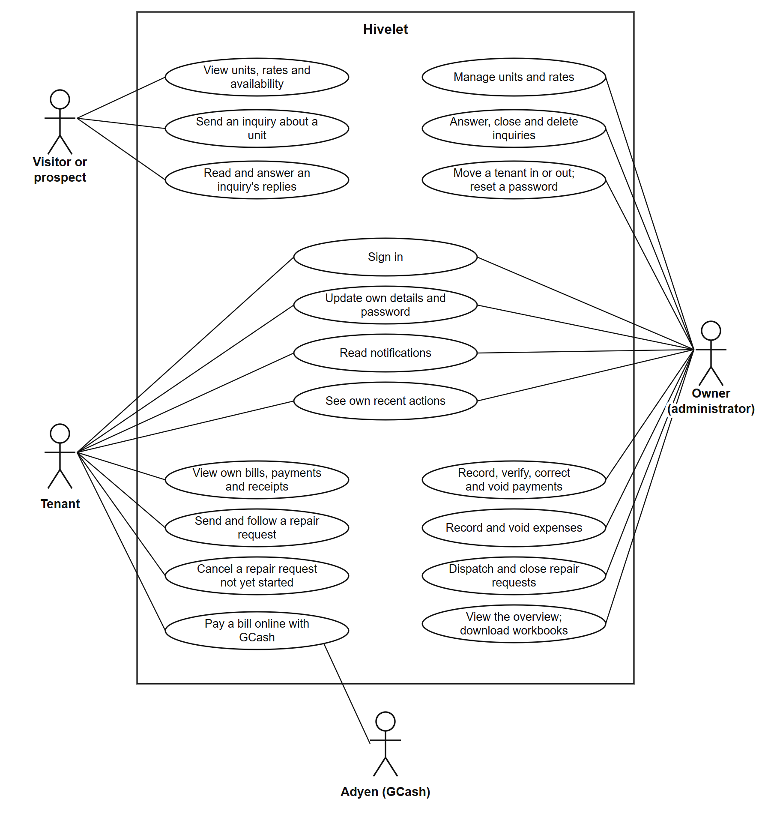

Figure 9, in Crow's Foot notation, is the entity-relationship diagram drawn from the database's own
catalogue on 5 October 2026: 21 tables, each with a primary key, and 37 foreign keys. Rooms and
profiles are its two centers: every bill, payment, receipt, tenancy, repair request and inquiry
belongs to one unit, and every tenancy, bill and payment to one person. The two ledgers are kept as
the owner kept them. Several rules live in the database itself, so no screen or script can bypass
them: one unit cannot have two active tenancies, one invoice number cannot be used twice for the same
unit and month, a gateway reference cannot be recorded twice, and the 50% Share and the remitted
amount are computed columns. Table 7A is an extract of the data dictionary for the table the owner
reads most; the complete dictionary, every column of all 24 tables, is in Appendix N.

*Figure 9. Entity-relationship diagram.*

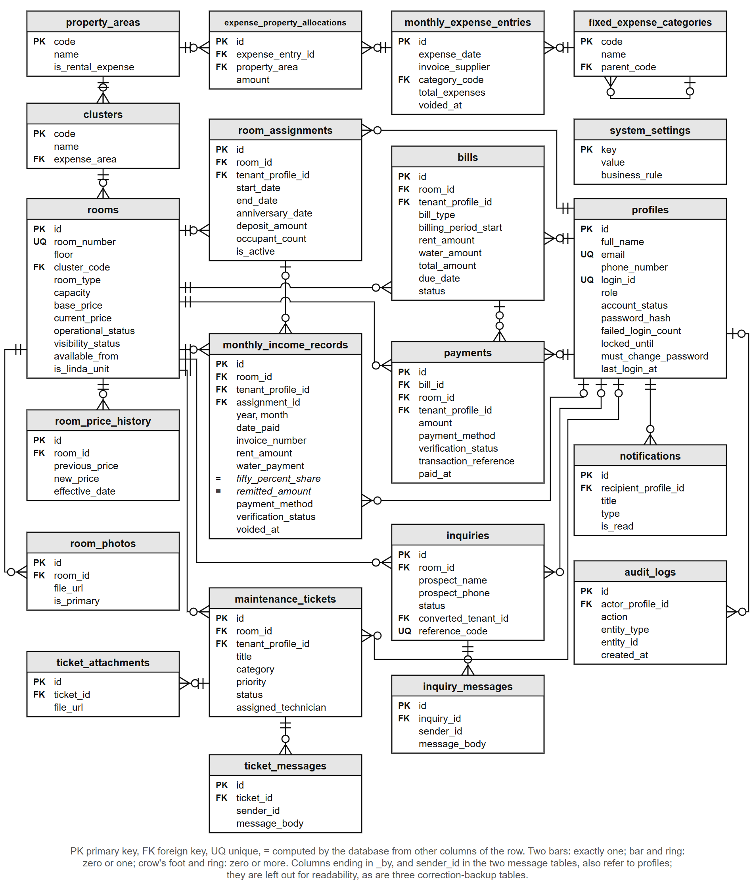

**Table 7A.** Data dictionary extract: monthly income records

| Column | Type | Null | Key | Description |
| :--- | :--- | :---: | :---: | :--- |
| id | uuid | No | PK | Identifies the receipt |
| room_id | uuid | No | FK | The unit the payment is for (rooms) |
| tenant_profile_id | uuid | Yes | FK | The tenant who paid, where one is recorded (profiles) |
| assignment_id | uuid | Yes | FK | The tenancy the payment belongs to, where known (room_assignments) |
| year, month | integer | No | | The ledger month the receipt is filed under |
| date_paid | date | No | | The day the money was received |
| contact_name | varchar(255) | No | | The name as written on the receipt |
| invoice_number | varchar(100) | Yes | | The owner's own invoice number; not repeated for the same unit and month among receipts that are not voided |
| rent_period_start, rent_period_end | date | No | | The period the rent covers (BR-033) |
| rent_amount | numeric(10,2) | No | | The rent received |
| occupants | integer | No | | The number of occupants that month |
| water_payment | numeric(10,2) | No | | The water fee, ₱200 per occupant (BR-014) |
| fifty_percent_share | numeric(10,2) | | Computed | A system-computed figure equal to half the row's Rent Amount, kept for ledger parity with the owner's historical spreadsheet (BR-035) |
| remitted_amount | numeric(10,2) | | Computed | Rent Amount plus Water Payment (BR-038) |
| payment_method | enumeration | No | | Cash, GCash, Bank Transfer or Adyen Online |
| verification_status | enumeration | No | | Verified, Pending Verification or Rejected |
| transaction_reference | varchar(120) | Yes | | The gateway's reference for an online payment; never recorded twice |
| is_linda_billing, linda_water_charge, linda_electricity_charge | boolean, numeric(10,2) | Yes | | The two Linda units' charges, recorded separately (BR-040) |
| voided_at, voided_by, void_reason | timestamp, uuid, text | Yes | voided_by: FK | When, by whom and why a receipt was voided; a voided receipt is kept, never deleted |
| created_at, updated_at | timestamp | Yes | | When the row was written and last changed |

### 4.2.2 Tenant and Room Management Module

Figure 10 presents the Rooms and rates screen. Each unit carries its cluster, floor, current rate and
status, and each tenancy the number of occupants, the move-in date and emergency contacts. When the
owner changes a rate, a database trigger records the old rate, the new rate, the date and who made the
change, so no path can change a rate without leaving that record. The owner's workbook did not record
move-in dates, so for the transferred tenancies the screen says the date is not recorded rather than
showing a guessed one. Since 13 October 2026 a tenant also sees the deposit held for their tenancy on
their own Overview, as one tenant asked in the survey (Table 23).

*Figure 10. Room and rate directory.*

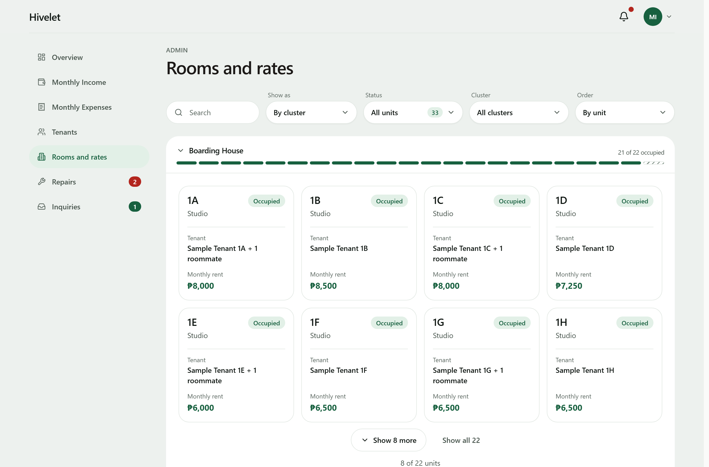

### 4.2.3 Booking and Reservation Management Module

Figure 11 presents the public unit catalogue and the inquiry form. A visitor sees each unit with its
rate, read live from the database, and sends an inquiry about a specific unit without an account. On
sending, the visitor receives a private link and a short reference code; either one (the code with the
phone number given) opens the conversation, where the owner's answer appears and the visitor can write
back. The link's secret is stored only in hashed form. An accepted inquiry becomes a tenancy linked to
it, a reserved unit accepts no new inquiries, and the public site never shows a tenant's name, which
is checked on every verification run against all 33 units.

*Figure 11. Public unit catalogue (top) and inquiry form (bottom).*

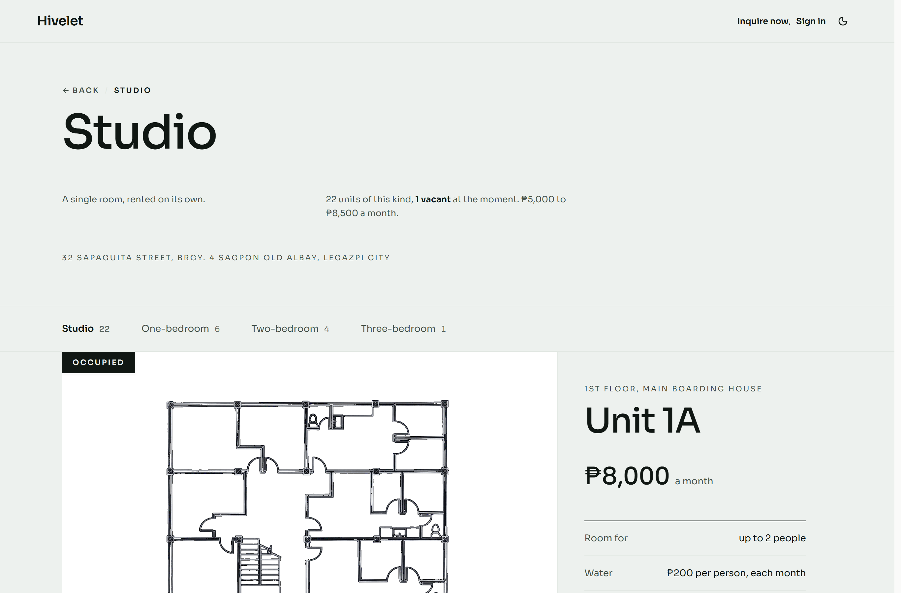

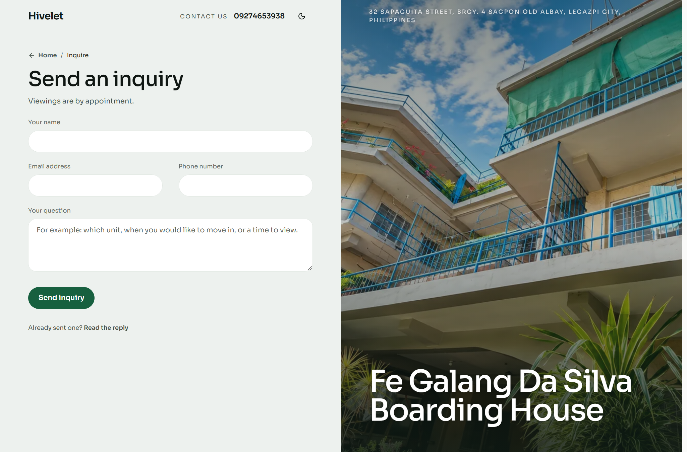

### 4.2.4 Financial Tracking and Payment Recording Module

Figure 12 presents the Monthly Income ledger. The owner records a cash payment with the number of the
invoice she issued, or with none, since not every payment has one; the system never makes up an
invoice number, and it warns her if the same tenant already has a payment for that month. The receipt
is filed under the month the rent is for, not the day it was paid, and both ledgers keep her
workbook's layout and download as Excel files in it. Online payments go through Adyen with GCash: a
payment made this way enters **Pending Verification** and changes nothing on the tenant's bill until
the owner verifies it. Tenants see the same record from their side, month by month, where only
receipts the owner has verified count as paid and a month with no receipt is shown as "Not entered",
never as owed, because the records alone cannot tell an unpaid month from one not yet entered.
Electricity is outside the system: each unit has its own meter and the tenant pays the electric
company directly.

*Figure 12. The monthly income ledger.*

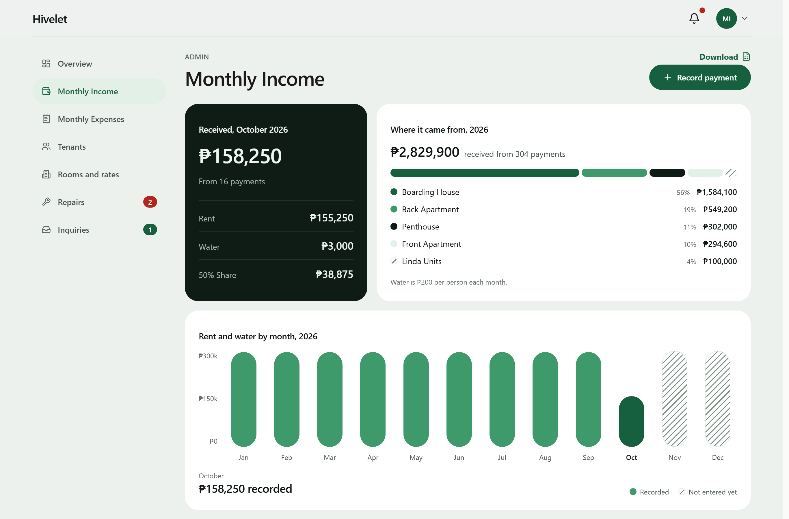

These results agree with Encarnacion et al. (2025) and Setty (2022), who found that one structured
ledger improves oversight and reduces administrative errors, and add one observation: the
consolidation also exposed errors already in the owner's records (Section 4.1.1). Every figure the
owner reads is computed from the rules in Table 7B rather than typed, so the same inputs always give
the same amount.

**Table 7B.** Business rules for computed figures, with a worked example

| Rule | What the system computes | Worked example |
| :--- | :--- | :--- |
| BR-014 Water fee | Water = number of occupants × ₱200 | Unit 2C with two occupants: 2 × ₱200 = ₱400 |
| BR-038 Remitted amount | Remitted = Rent Amount + Water Payment | ₱8,500 + ₱400 = ₱8,900 |
| BR-035 50% Share | A system-computed figure equal to half that row's Rent Amount, kept for ledger parity with the owner's historical spreadsheet | ₱8,500 ÷ 2 = ₱4,250 |
| BR-033 Rent period | The period a payment covers, from the tenancy's anniversary date | Anniversary on the 13th: rent for 13 August to 12 September |
| BR-010, BR-011, BR-012 Due date and overdue | Due on the date the billing cycle sets; overdue from the next day, with no grace period | Due 13 September: overdue from 14 September |
| BR-039 Deposit | Equal to the rent in effect at move-in, set once | Moved in at ₱8,500: deposit ₱8,500 |
| BR-040 Linda's units | Water at the same ₱200 per occupant, recorded separately and kept out of the remitted amount | Unit LF with two occupants: ₱400 recorded as Linda's water; remitted = rent only |
| BR-045 Expense total | An expense entry's total = the sum of its allocations to property areas | ₱6,000 to the Boarding House + ₱2,000 to the Main House = ₱8,000 |

### 4.2.5 Maintenance Ticketing and Notification Module

Figure 13 presents the repairs board. A tenant submits a request with a title, description and
priority, follows it through to completion, and may cancel it before work starts. The owner can also
log a repair she is told about in person, including one for an empty unit. Only the owner closes a
request, and the tenant is notified when it is done. In-app notifications also tell a tenant when a
payment is verified or declined, and the owner when a payment, inquiry or comment arrives; opening one
opens the record it is about. This is the change Saputra et al. (2025) report, in which complaints
turned into traceable requests improved accountability, and it bears on the responsiveness Jing and
Lim (2021) found central to residents' satisfaction: a request now carries its status from submission
to closing, where before it left no record (Figure 4).

*Figure 13. Maintenance requests board.*

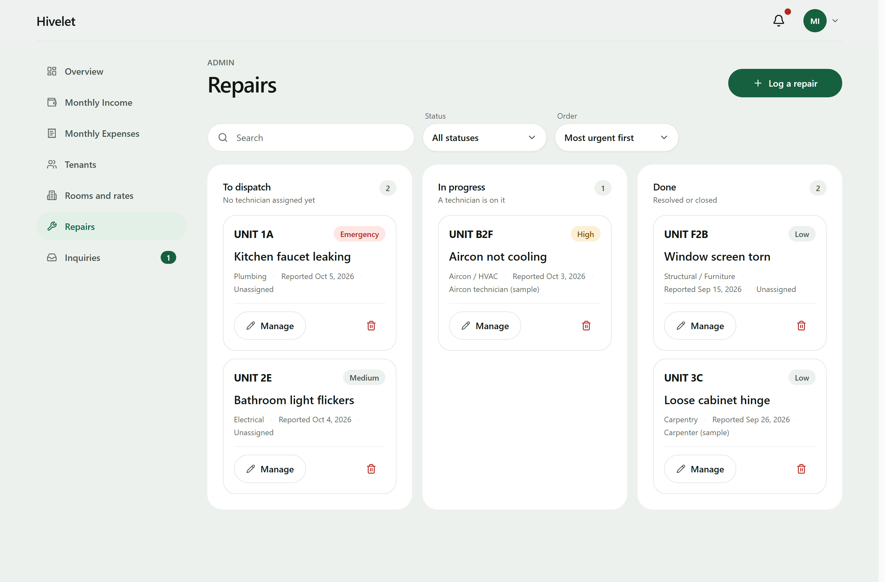

### 4.2.6 Role-Based Access Control

The system has the three kinds of user designed in Section 3.2.2, the public, tenants and the
administrator, plus a record of each visitor who sends an inquiry (a *prospect*), who holds the
public's rights. Every role's rights come from one permission matrix, against which each of the 55
administrator and tenant routes is checked on every verification run, and row-level security is on
for every table. Table 7C sets out which role may use which function.

**Table 7C.** Role and privilege matrix

| Function | Visitor | Tenant | Administrator |
| :--- | :---: | :---: | :---: |
| View the public site, units and rates | Yes | Yes | Yes |
| Send an inquiry and read the reply (private link or reference code) | Yes | Yes | Yes |
| View and update their own details and password | No | Own | Own |
| View a unit, its bills, payments and receipts | No | Own | All |
| Pay a bill online with GCash | No | Own | No |
| Send, follow and cancel a repair request | No | Own | All, and dispatch or close |
| Receive notifications | No | Own | Own |
| Manage units and rates | No | No | Yes |
| Manage tenants: move in, move out, reset a password | No | No | Yes |
| Record, verify, correct and void payments | No | No | Yes |
| Income and expense ledgers, overview figures and workbook downloads | No | No | Yes |
| Answer, close and delete inquiries | No | No | Yes |

Passwords are stored as bcrypt hashes with a per-password salt; a new one needs ten characters, a
letter and a number, and is refused if it appears in a public list of breached passwords. An account
locks after five failed sign-ins, a new account must change its password at first sign-in, and every
administrator action is written to an audit trail the application cannot edit, delete or empty. The
testing of these protections is reported in Section 4.4.4.

### 4.2.7 Progressive Web Application Implementation

Figure 14 presents the tenant portal on a phone. The client is a Progressive Web Application with a
service worker and a manifest, so it installs on a phone or computer without an app store. Installing
it means adding it to the home screen from the browser (**Add to Home Screen** in Safari, **Install
app** or **Add to Home screen** in Chrome): nothing is downloaded from a store, it opens in its own
window like an application, and the application files it keeps on the device come to about 1.2 MB
(as built on 13 October 2026). Since 1
and 2 October 2026 it keeps a read-only copy of the figures, names and notifications the signed-in
person last loaded on that person's device, so the installed application can show them without a
connection under one notice giving the time they were saved; paying and recording still need the
connection, and the copy is removed at sign-out. This stays within the delimitation in Section 1.4.
Screens adapt to the device, and tables on a computer become cards on a phone. As Biørn-Hansen et al.
(2019) describe, one code base served every device: the owner's laptop, an Android phone in Chrome
and an iPhone in Safari (Section 4.3.7).

*Figure 14. The tenant portal on a mobile phone.*

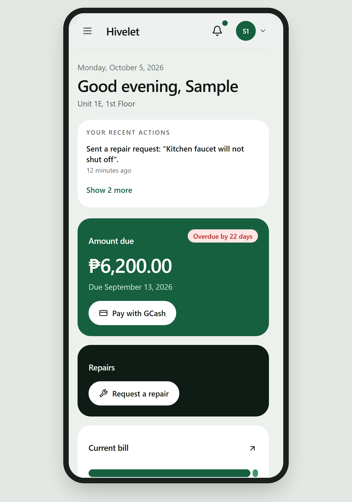

---

## 4.3 Pilot Testing of the Developed System

*Answers Objective 3: functionality, responsiveness and operational performance.*

The three qualities Objective 3 names are characteristics of ISO/IEC 25010:2011: functionality is
**Functional Suitability**, responsiveness the time behavior of **Performance Efficiency**, and
operational performance its capacity and **Reliability**. A test written for one quality often
measures others, so Table 7D lists each test activity with every characteristic it measured. The
measures are brought together by characteristic in Section 4.4.

**Table 7D.** Test activities and the ISO/IEC 25010:2011 characteristics they measured

| Test activity (Section) | Test level | Characteristics measured (sub-characteristics) |
| :--- | :--- | :--- |
| Automated verification (4.3.1) | Unit and integration | Functional Suitability (correctness); Security (confidentiality, integrity, authenticity); Compatibility (interoperability); Maintainability (testability) |
| Use in the live environment (4.3.2) | System, in operation | Functional Suitability (correctness); Compatibility (interoperability); Reliability (recoverability) |
| Screen-versus-database audit (4.3.3) | System | Functional Suitability (correctness); Reliability (maturity) |
| Functional walkthrough (4.3.4) | System | Functional Suitability (completeness, correctness); Usability (user error protection); Security (confidentiality); Reliability (fault tolerance) |
| Responsiveness (4.3.5) | System | Performance Efficiency (time behavior, resource utilization) |
| Offline, installation, weak connections and simultaneous users (4.3.6) | System | Reliability (fault tolerance); Performance Efficiency (capacity); Portability (installability, adaptability); Usability (accessibility) |
| User acceptance testing (4.3.7) | Acceptance | Quality in use (effectiveness, efficiency, context coverage); Usability (learnability, operability); Security (confidentiality) |

### 4.3.1 Automated Verification

Twenty automated check suites were written during development. They run against the live system and
perform no writes, which is what makes them safe to run against the owner's real records. On 29
September 2026, the evening before the first test with real users, all 20 passed; Table 8 shows the
principal results.

**Table 8.** Results of automated verification (29 September 2026)

| Suite | What it checks | Result |
| :--- | :--- | :--- |
| Endpoint and access control | Every endpoint the client calls, the separation of roles, and the rejection of bad input | 78 of 78 passed |
| Ledger integrity | All 937 income rows against the business rules; room, tenant and occupancy agreement | Passed; 5 receipt anomalies reported for the owner |
| Report reconciliation | The exported Excel reports against the database, month by month | 490 of 490 passed |
| Payment gateway | Signature checking on gateway messages and how each kind of message is recorded | 73 of 73 passed |
| Record relations | That separate records agree with each other (payments with bills, tickets with units) | 30 of 30 passed |
| Billing arithmetic | Water, billing period and how a payment is split across bills | Passed |
| Data presentation | That no screen shows stored, sample or empty data as a live figure | 6 of 6 passed |
| Interface integrity | That every screen component exists, every input has a label, and every source file is used | Passed |
| Document consistency | That the requirements matrix and business rule register agree with themselves | Passed (44 requirements, 49 rules) |

The checks found what nobody had written a check for: the five receipt anomalies of Section 4.1.1
came from the owner's records and are reported on every run rather than corrected, because only her
invoice book can say what each should read. More important, the most serious defects found in
development gave no error on screen. A cash payment could be confirmed while nothing was written to
the ledger, and a partial payment could be recorded while the remaining debt was lost. Each was fixed
and now has a check that fails if it returns, which is the case for automated verification in a
system that holds real money: the most dangerous defects are the silent ones.

### 4.3.2 Use in the Live Environment

The system has run at a public address with the owner's real records since September 2026. On 22
September a checkout raised the first real bill, ₱8,200.00 for unit 1a, exactly as the rules compute
it, and a test receipt voided four minutes after it was recorded returned the ledger to its 937 rows.
On 23 September the owner found the system hard to use on her phone; the causes were measured (a table
518 pixels wide on a 301-pixel screen, edit buttons touch screens never showed) and fixed the same day.
GCash payments were refused at first by a misconfigured acquirer account on Adyen's side, which Adyen
support confirmed and replaced (Case 08657379); on 26 September a test payment passed end to end, from
Adyen's authorization to the owner's verification queue. Every record the pilot tests created was then
removed by one reviewed migration after a backup, leaving the owner's 937 income rows untouched.

### 4.3.3 Screen-versus-Database Audit

The suites prove each part correct on its own, not that a screen shows a person what the database
holds for them. On 26 September 2026 a tenant's payment history read "Nothing recorded" although the
tenant had seven receipts that year, while every suite passed. The team therefore compared every
figure on every owner screen, and on the tenant screens on 29 September, with a read-only query of
the live database for the same records. Table 9 shows the result.

**Table 9.** Results of the screen-versus-database audit (26 and 29 September 2026)

| Screen | What was compared | Result |
| :--- | :--- | :--- |
| Owner overview | Collections for each month of 2026, the year's total, occupancy, rent per cluster, expected monthly income, operating and personal costs | Matched to the peso |
| Monthly Income | Totals for rent and water (and a garbage fee, removed on 30 September); collections by cluster | Matched after one defect was fixed |
| Monthly Expenses | Total spent, split by kind and by area | Matched; one layout defect fixed |
| Rooms and rates | Rent and number of occupants for each unit | Matched |
| Tenants | Number of tenants per cluster; move-in dates | Counts matched; one defect fixed |
| Activity (audit trail) | Each recent entry against the recorded action | One defect fixed |
| Repairs, inquiries | Number of open items | Matched |
| Tenant payments | A tenant's receipts for 2026 | Two defects fixed |
| Tenant overview, repairs and details (29 Sep 2026) | Unit, rate, occupants, monthly charge (rent plus ₱200 per occupant), the period the receipts reach, amount due, requests, contact details | Matched |

The audit found six defects no automated check had caught, all fixed on 26 September: a tenant's
payment history that read only online payments, rental and personal expenses in one column, a
placeholder move-in date shown for every tenant, an opened checkout listed as a recorded payment, a
voided receipt in a tenant's receipt list, and the Boarding House's remitted amount halved on the
income screen. The lesson is the reverse side of Section 4.3.1: **passing checks show that what was
tested is correct, not that everything is.** It qualifies Magno et al. (2024), who found that digitizing transaction tracking improves data
accuracy: here every record was already digital and in one database, yet six screens disagreed with
it, so digitizing alone did not make the records agree.

### 4.3.4 Functional Walkthrough Testing

A 26-step walkthrough, 30 rows counting its sub-steps, exercises every function that writes data
once, on the one unoccupied unit so that no real record is touched. The owner performed it herself on
30 September 2026 on her laptop, signed in to her own account, with a team member reading each step;
the full results are in Appendix M, Table M-1. Of the 30 rows, 24 passed the first time, 1 failed and
5 were not performed as written. Every function a tenant uses passed, as did onboarding, the duplicate
guards, voiding, inquiry replies, repairs, the Excel export and moving a tenant out. The one failure
was step 23b: with the connection cut, the Overview showed ₱0 where the design requires "—", so that
a missing figure is never read as a zero balance; re-tested on the owner's laptop on 13 October 2026,
it passed (Table 23A). A rate change and its reversal were
skipped, and an expense split across two areas was entered as two expenses, so splitting, editing
and deleting an expense were not exercised by the owner.

### 4.3.5 Responsiveness and Operational Performance

Response times were measured on 30 September 2026 on the live system, on a Dell XPS 15 laptop in
Google Chrome 154 over the boarding house's Wi-Fi and on an iPhone 15 in Safari over mobile data, from
the tap until the figures the user came for were
on screen (Table 11).

**Table 11.** Page load and response times (30 September 2026, seconds)

| Screen | Laptop (Dell XPS 15, Chrome 154, Wi-Fi) | Phone (iPhone 15, Safari, mobile data) |
| :--- | --: | --: |
| Public home page, first load | 1.85 | 2.42 |
| Public home page, second load | 0.62 | 0.95 |
| Sign-in to dashboard | 2.10 | 2.88 |
| Income ledger, one full year | 1.45 | not measured |
| Excel export of one year | 2.30 | not measured |
| Tenant portal, first load | 2.15 | 3.05 |
| Tenant payments page | 1.20 | 1.78 |
| Sending a repair request | 1.65 | 2.10 |

Every screen was usable within about three seconds on the phone and a little over two on the laptop,
the slowest being the tenant portal's first load (3.05 seconds on the phone). Google's PageSpeed
Insights, emulating a mid-range phone on slow 4G, scored the public page 85 to 88 with its largest
element at 3.4 to 3.6 seconds, and 100 for accessibility; on the owner's Overview, Lighthouse found
the page moving as its figures arrived (a layout shift of 0.22) and 0.7 seconds of script work on the
phone (Chapter 5, recommendation 5).

### 4.3.6 Offline Use, Installation, Weak Connections and Simultaneous Users

On 29 September 2026 the live system was measured with no connection, on a weak one, once installed,
and with many requests at once, using an automated browser in phone emulation with every save blocked
so that nothing was written to the owner's records. Table 11A gives the results without a connection
and once installed. Table 11B gives those of a load test in which a script played several users at
once, each pausing between requests as a person reading does; these were simulated users, not people
(the owner and tenants together are reported in Section 4.3.7).

**Table 11A.** Offline and installation behavior (29 September 2026)

| Test | Result |
| :--- | :--- |
| Installation requirements (manifest, service worker, icons) | Met; the service worker keeps 67 application files on the device after the first visit |
| Opening ten addresses with no connection | The application opened on all ten in about 1.5 seconds instead of the browser's "no internet" page |
| Tenant and administrator pages with no connection, signed out | The application opened and asked for sign-in; no personal or financial data was shown |
| Notice when the connection drops | Shown at once: "No connection. You can read what is already loaded, but nothing can be saved or paid until it is back." |
| Notice when the connection returns | "Back online" |
| Public unit list with no connection | Shown from the device's memory |
| Public unit list when the server stops answering | Shown from the device's memory after 3.1 seconds |
| Public page on a slow connection (400 kbps, 400 ms), first visit | Units on screen after 4.6 seconds |
| The same page, returning visitor | Units on screen after 0.3 seconds, because the installed application already holds its files |

**Table 11B.** Simulated simultaneous users, read operations (29 September 2026)

| Test | Simulated users at once | Duration | Requests | Errors | Slowest 5% took longer than |
| :--- | --: | --: | --: | --: | --: |
| Public pages and public data, live site | 12 | 60 s | 1,085 | 0 | 0.52 s |
| The owner's ten main data requests, live database | 6 | 45 s | 285 | 0 | 0.80 s |

The application opens without a connection and says plainly what it cannot do, and under loads
several times the property's own no request failed and nineteen in twenty were answered in under a
second. The tests found one weakness: on a weak signal a page could wait for minutes with no message.
A limit was added that evening, so that a page stops after 25 seconds and says it could not reach the
server, and a save stops after 45 seconds and says it **cannot tell whether the save arrived, so the
reader should check before sending it again**. An accessibility scan of the public pages (axe-core 4,
WCAG 2 A and AA) at phone and computer widths found no violation, nor did the same scan of the
owner's eight screens.

**Simultaneous saves.** Reading at the same time tests capacity; saving at the same time tests
correctness, because two requests that arrive together can each pass a check before either has been
saved. This was tested by sending the same request several times in the same instant, which
reproduces a double click, a retry after a timeout, or two people pressing Save together, with closer
timing than people can produce by hand (Table 11F).

**Table 11F.** Simultaneous saves (19 and 24 September 2026)

| Test | Before the change | After the change |
| :--- | :--- | :--- |
| The same receipt sent twice at once, live system | Both saved: 2 rows | 1 saved, 1 refused: 1 row |
| The same receipt sent five times at once, live system | All five saved: 5 rows | 1 saved, 4 refused: 1 row |
| One receipt covering three months, live system | | Saved as 3 rows, June to August 2026, as before |
| Two GCash checkouts opened on one bill at once, payment code with a stand-in database | Both opened, so both payments could be recorded | 1 opened, 1 refused |
| A checkout 16 minutes after one was abandoned | | Opened: an abandoned checkout holds the bill for 15 minutes, not for good |

Neither fault showed an error, and neither could be fixed in the program alone, since a check
followed by a save can always be outrun. Each fix is a rule in the database, which refuses the second
save whatever order the requests arrive in, so ten requests arriving together meet the same refusal
as two. Since 12 October 2026 a twenty-first suite repeats these tests on every run against the
system's own request handlers; it passes 15 checks, and each of four deliberate faults made it fail.
Two limits remain: the rule covers receipts with an invoice number, so two identical receipts without
one, or two acknowledgement receipts, arriving at the same instant would both be saved, which the
payment form's confirmation step makes unlikely without ruling out; and two people changing the same
record in different ways at once was not tried.

### 4.3.7 User Acceptance Testing with the Owner and Tenants

> **TEAM NOTE.** Once the owner has signed the acceptance form (Appendix O), add after this section's first
> paragraph: "The owner's signed acceptance form is in Appendix O." If she does not accept it yet, say what she
> asked for instead. The guide does not allow UAT results without a signed form (Q4.3.8-4).

The owner and three tenants used the live system for their own tasks on 30 September 2026, each on
their own device and account, after giving written consent, by the procedure in Section 3.3. Where an
observer's sheet and the system's activity record disagreed, the activity record was used. Table 11C
gives each task's result.

**Table 11C.** Tenant task results (30 September 2026)

| Task | Tenants attempting | Completed without help | Completed with help | Not completed | Median time (s) | Mean wrong turns | Completion without help |
| :--- | --: | --: | --: | --: | --: | --: | --: |
| First sign-in and choosing a password (T-01, T-02) | 3 | 4 | 2 | 0 | 120 | 0.5 | 67% |
| Finding their unit, rent and balance (T-03, T-04) | 2 | 3 | 1 | 0 | 90 | 0.5 | 75% |
| Finding their payments (T-05, T-06) | 2 | 4 | 0 | 0 | 60 | 0.0 | 100% |
| Sending a repair request with a photo (T-07 to T-09) | 3 | 7 | 0 | 0 | 90 | 0.0 | 100% |
| Following up a request (T-10, T-11) | 2 | 3 | 0 | 0 | 120 | 0.0 | 100% |
| Checking their details and notifications (T-12, T-13) | 3 | 5 | 0 | 0 | 60 | 0.2 | 100% |
| Opening the GCash payment (T-14) | 2 | 2 | 0 | 0 | 120 | 0.0 | 100% |
| Staying out of the owner's pages; signing out (T-15, T-16) | 2 | 3 | 0 | 0 | 60 | 0.0 | 100% |
| **All tasks** | 3 | 31 | 3 | 0 | 60 | 0.2 | 91% |

Every task the tenants attempted was completed, 31 of 34 attempts without help (91 percent). Help
was needed only at the start: two of the three tenants were helped through their first sign-in and
one to find their unit and rent; everything else, from finding payments to reporting a repair and
opening the GCash payment, was done alone in one to two minutes. The repairs they sent reached the
owner at once, and she acted on them the same evening. Mia et al. (2024) name limited technical
capacity as a barrier when small Philippine enterprises adopt digital tools; these results place it
precisely, in the first two things a new user does. The tests that needed several tenants saving at
once were not performed, because only two attended together; in the session in which the owner and
two tenants used the system at the same time, every screen loaded, each tenant saw only their own
unit, the owner's full year of Monthly Income opened in about three seconds, and no session
affected another (Appendix M, Table M-22). On two phones the offline behavior
matched Table 11A, except that the Android phone showed the "cannot tell whether it was saved" message
after 60 to 80 seconds instead of 45; corrected on 1 October, it was on time when re-tested on that
phone on 13 October 2026 (Table 23A).

Table 11E brings the testing together by the test levels of ISO/IEC/IEEE 29119 (Section 3.2.4).

**Table 11E.** Summary of test execution by level

| Level | Activity (source) | Executed | Passed | Failed | Not performed or not applicable | Pass rate |
| :--- | :--- | --: | --: | --: | --: | --: |
| Unit and integration | Automated check suites, 29 September 2026 (Table 8) | 20 | 20 | 0 | 0 | 100% |
| System | Functional walkthrough by the owner, 30 September 2026 (Appendix M, Table M-1) | 25 | 24 | 1 | 5 | 96% |
| Acceptance | Tenant tasks, 30 September 2026 (Table 11C) | 34 | 34 | 0 | 0 | 100% (91% without help) |
| Acceptance | Simultaneous use by the owner and tenants (Appendix M, Table M-22) | 4 | 4 | 0 | 3 | 100% |
| **All levels** | | **83** | **82** | **1** | **8** | **98.8%** |

Every level passed at least 96 percent of the tests executed, against the course standard of 90 per
cent. The one failure, at the system level, was not critical, and no critical defect was found in any
activity. Table 23A, in Section 4.4.6, lists the defects by activity, severity and disposition.

---

## 4.4 Evaluation of the System Based on ISO/IEC 25010

*Answers Objective 4.*

The evaluation followed the five steps of ISO/IEC 25040 (Table 12B), on the quality model of ISO/IEC
25010:2011. That edition was used because the approved proposal (Section 3.3) named its eight
characteristics as the evaluation criteria, and the instrument was built on them; the same edition is
used in Chapter 3 and here. Each characteristic was judged on
**measured quality**, the results of Section 4.3 expressed as measures of its sub-characteristics in
the manner of ISO/IEC 25023, and on **rated quality**, a survey in which each item belongs to one
sub-characteristic (Chapter 3, Table 4B). Each respondent group rated only what it can judge: tenants
did not rate Security or Maintainability, prospective tenants rated neither, and only technical
evaluators rated Maintainability, the group with the background to judge it.

**Table 12B.** The evaluation process, following ISO/IEC 25040

| Step | What it required | How it was carried out |
| :--- | :--- | :--- |
| 1. Establish the evaluation requirements | The purpose, the product, the quality model and who judges it | Objective 4; the live system at its public address; ISO/IEC 25010:2011, eight characteristics; the owner, tenants and technical evaluators (Section 3.3) |
| 2. Specify the evaluation | The measures for each sub-characteristic, and the criteria for judging them | Measures from the tests of Section 4.3 (Table 7D); survey items assigned to sub-characteristics (Chapter 3, Table 4B); criteria: Table 13 for every mean, and for tests the course standard of at least 90 percent passed with no critical defect open |
| 3. Design the evaluation | The activities, their order and schedule | Measurements on 29 September 2026; the walkthrough and acceptance test on 30 September; the technical evaluators' review on 3 October; the survey after each group's use of the system |
| 4. Execute the evaluation | Take the measures and apply the criteria | Section 4.3 (measured) and the survey (rated; Appendix M, Tables M-2 to M-17) |
| 5. Conclude the evaluation | Review the results, report them, and act on them | Tables 22 and 22A, and the changes made in response (Table 23) |

ISO/IEC 25010 was revised in 2023, renaming Usability as *Interaction Capability* and Portability as
*Flexibility* and adding *Safety*. The survey was built and answered on the 2011 characteristics, so
its results are reported on them; Appendix M, Table M-21, shows where each falls in the revised
model.

### 4.4.1 Respondents

Table 12 shows the respondents by group, and Table 12A how many forms were given out and returned.

**Table 12.** Distribution of respondents

| Group | Number | Percent |
| :--- | ---: | ---: |
| Owner / administrator | 1 | 16.67% |
| Tenants | 3 | 50.00% |
| Technical evaluators | 1 | 16.67% |
| Prospective tenants | 1 | 16.67% |
| **Total** | **6** | 100% |

**Table 12A.** Instrument administration and response rate

| Group | Distributed | Retrieved | Valid | Response rate |
| :--- | ---: | ---: | ---: | ---: |
| Owner / administrator | 1 | 1 | 1 | 100% |
| Tenants | 3 | 3 | 3 | 100% |
| Technical evaluators | 1 | 1 | 1 | 100% |
| Prospective tenants | 1 | 1 | 1 | 100% |
| **Total** | **6** | **6** | **6** | **100%** |

Six people answered, each after using the system and giving consent: the prospective tenant and the
three tenants on 30 September 2026, after their tasks in Section 4.3.7, the owner that night after
her walkthrough, and one technical evaluator on 4 October, the day after the evaluators' review. No
member of the development team was among them. Three of the four groups have one respondent each, so
for those groups a mean is one person's rating, and the results describe how these six people rated
the system, not a sample from which a wider population can be inferred.

### 4.4.2 Interpretation of Scores

Each item was rated on the five-point scale in Table 4, and means are read using Table 13. The
composite of each characteristic is the mean of its group means, so that one owner is not outweighed
by three tenants on functions only she uses, and the overall mean is the mean of the eight
composites. Averaging every response together instead gives 4.55 rather than 4.53, with the same
interpretation and ranking. Table 13A works one weighted mean in full, WM = Σ(f × w) / N.

**Table 13.** Interpretation of mean scores

| Mean score | Verbal interpretation |
| :--- | :--- |
| 4.21 – 5.00 | Very High Quality |
| 3.41 – 4.20 | High Quality |
| 2.61 – 3.40 | Moderate Quality |
| 1.81 – 2.60 | Low Quality |
| 1.00 – 1.80 | Very Low Quality |

**Table 13A.** Worked computation of a weighted mean

| Rating (w) | Meaning | Frequency (f) | f × w |
| ---: | :--- | ---: | ---: |
| 5 | Strongly Agree | 3 | 15 |
| 4 | Agree | 0 | 0 |
| 3 | Neutral | 0 | 0 |
| 2 | Disagree | 0 | 0 |
| 1 | Strongly Disagree | 0 | 0 |
| **Total** | | **N = 3** | **Σ(f × w) = 15** |

Indicator: "I can see my own unit details, my bill, and what I still owe." (Functional Suitability,
rated by tenants). WM = 15 / 3 = **5.00**, which Table 13 reads as **Very High Quality**.

### 4.4.3 Results by Characteristic

Table 22 summarizes the result for each characteristic; the rating of every item by every group is
in Appendix M (Tables M-2 to M-17, ratings and measured evidence for each characteristic).

**Table 22.** Summary of evaluation results

| Characteristic | n | Composite mean | Interpretation | Rank |
| :--- | ---: | ---: | :--- | ---: |
| Functional Suitability | 6 | 4.86 | Very High Quality | 2 |
| Performance Efficiency | 6 | 4.42 | Very High Quality | 6 |
| Compatibility | 6 | 4.67 | Very High Quality | 4 |
| Usability | 6 | 4.12 | High Quality | 7 |
| Reliability | 6 | 4.62 | Very High Quality | 5 |
| Security | 2 | 4.70 | Very High Quality | 3 |
| Maintainability | 1 | 4.00 | High Quality | 8 |
| Portability | 6 | 4.89 | Very High Quality | 1 |
| **Overall** | | **4.53** | **Very High Quality** | |

The six respondents rated the system **Very High Quality overall (4.53)**, and no characteristic, and
no group mean, fell below High Quality. This is the range Canlas et al. (2026) report for a Philippine
dormitory system rated by the same kinds of respondents, tenants, administrators and IT professionals;
here, each rating is also read beside the measured evidence for its characteristic (Section 4.4.5).

**Portability** was rated highest (4.89), as one code base installed on an Android phone and an
iPhone without an app store. **Functional Suitability** followed (4.86): every feature the objective
names is present, and 96 to 100 percent of the executed checks of correctness gave the right result.
**Security** (4.70) is discussed in Section 4.4.4. **Compatibility** (4.67) agrees with the browser
matrix, on which every combination tried worked. **Reliability** (4.62) agrees most closely with the
testing: the technical evaluator's 3 for handling a failed request without presenting incorrect data
names the one defect the testing found, the ₱0 of step 23b, since resolved. **Performance Efficiency** (4.42)
matches the measurements: no failed request, but screens of two to three seconds on a phone.

The two lowest were rated High Quality. **Usability (4.12)** is the lowest of the characteristics all
four groups rated. The prospective tenant gave every item 5 and the tenants 4.47, but the owner gave
3 to telling what each screen is for and to learning the system without help, and the technical
evaluator gave 3 to all five items. The evaluator answered before the fourteen changes made for that
evaluator's group, eleven of them about usability, and the owner learned the system with each step
read to her (Section 4.3.4). Here the rating and the measurement disagree and both are right: nine
tasks in ten were done without help and 76 accessibility scans of 19 screens found no violation once
one defect on three screens was corrected, but
those measure whether a task can be done and whether a screen is built correctly, not how easily a
first-time user finds the way. **Maintainability (4.00)** is the lowest composite and rests on one
respondent, who gave every item 4 after reviewing the running system, without inspecting its source
code, so here the measurement, read from the code itself, carries more weight than the rating. The
measurement agrees: the system can be checked as a whole on
every change, but three database calls in four are written inside the request handlers, so the rules
for one record are spread across the handlers that touch it. Both are taken up in Chapter 5,
recommendation 6.

### 4.4.4 Security

The owner gave every Security item 5. The technical evaluator gave 5 to role restriction, to a tenant
being kept out of administrative data and to the audit trail, 4 to authentication and session
handling, which agrees with two low-risk session weaknesses the code review accepted, and 3 to the
handling of credentials, for which the measured evidence gives no cause and the form gave no reason.
Three passive external scans graded the site **A+**: Qualys SSL Labs, Mozilla HTTP Observatory (all 12
tests passed once the Content Security Policy was enforced) and securityheaders.com, on 29 and 30
September 2026. Twelve checks by hand passed, among them an account locking after five wrong
passwords, no personal data behind the Back button after signing out, and another tenant's repair
answering "not found". A review of all 71 request handlers on 2 October found no high-severity
problem, and Supabase's security advisor raised no warning on 5 October. Two weaknesses remain by
design. The sign-in token is kept in the browser's storage, where an injected script could read it,
which the enforced Content Security Policy and the absence of any raw HTML on the screens stand
against; and sign-in takes a password only, with no second factor even for the administrator. Both
are left to Chapter 5, recommendation 3.

### 4.4.5 Measured and Rated Evidence Together

Table 22A sets the two kinds of evidence side by side. Of the thirty-one sub-characteristics of
ISO/IEC 25010:2011, twenty-seven have a measured result and twenty-five are rated by at least one
survey item; two, user interface aesthetics and reusability, have neither, and no conclusion is drawn
about them.

**Table 22A.** Measured and rated evidence by characteristic

| Characteristic | Sub-characteristics | Measured | Rated | Measured result (Appendix M) | Composite mean (Table 22) |
| :--- | ---: | ---: | ---: | :--- | ---: |
| Functional Suitability | 3 | 3 | 3 | All six features present; 96 to 100 percent of correctness checks passed | 4.86 |
| Performance Efficiency | 3 | 3 | 3 | No request failed under load; every screen usable within 3.05 s on a phone | 4.42 |
| Compatibility | 2 | 1 | 2 | 5 of 5 device and browser combinations; gateway and spreadsheet exchange correct | 4.67 |
| Usability | 6 | 5 | 4 | 91 percent of tasks without help; 0 accessibility violations in 76 scans | 4.12 |
| Reliability | 4 | 3 | 4 | No critical defect; the two offline defects found on real devices, a ₱0 shown for a figure that could not load and a late message, both passed on re-test, 13 October | 4.62 |
| Security | 5 | 5 | 3 | Every protection tried held; A+ from all three outside scanners | 4.70 |
| Maintainability | 5 | 4 | 4 | 20 of 20 suites pass without writing to the records; every change a numbered migration; but 154 of 204 database calls inside the request handlers | 4.00 |
| Portability | 3 | 3 | 2 | No screen wider than its window at four widths; installed on two phones without an app store | 4.89 |
| **All** | **31** | **27** | **25** | | **4.53** |

For seven of the eight characteristics the two kinds of evidence agree, and they disagree on
Usability for the reason given in Section 4.4.3: passing measures show what was measured. Quality in
use, which ISO/IEC 25010:2011 defines as the quality experienced by users in their own context, was
measured by the acceptance test of Section 4.3.7 in the manner of ISO/IEC 25022: effectiveness, all
34 attempted tasks completed, 31 of them without help; efficiency, a median of 60 seconds a task with
0.2 wrong turns; and context coverage, the owner's laptop, an Android phone and an iPhone (Appendix M,
Table M-20).

### 4.4.6 Optimization in Response to the Evaluation

Objective 4 asks for the system to be evaluated **and optimized**. Table 23 groups the 51 changes made
in response to feedback and testing by where each finding came from; every change, with its finding
and the characteristic it serves, is in Appendix M, Table M-18. Most were made the day the finding
arrived, and each of the technical evaluators' fourteen comments of 3 October 2026 was addressed on
the live system by 5 October.

**Table 23.** Optimizations made in response to evaluation, by source

| Source | Changes | Characteristics served | Examples of what was found |
| :--- | --: | :--- | :--- |
| The owner's review on a phone, 23 Sep 2026 | 4 | Usability, Portability | Edit buttons that touch screens never showed; a tenant register wider than the phone |
| Screen-versus-database audit, 26 Sep 2026 | 7 | Functional Suitability, Reliability, Usability, Security | A payment history showing no payments; a placeholder move-in date for every tenant |
| Development reviews, 26 to 28 Sep 2026 (performance, requirements, team, client, mobile, checks, final review) | 11 | Usability, Functional Suitability, Reliability, Performance Efficiency, Portability | Repairs for an empty unit; page names that differed between menu, tab and heading |
| Pre-testing audit and Lighthouse, 29 and 30 Sep 2026 | 5 | Usability, Security, Performance Efficiency, Reliability | One shared starting password for every tenant; no way back for a forgotten password |
| Testing day, 30 Sep 2026 (owner's use, walkthrough, Android phone) | 3 | Reliability, Usability | Changes not reaching the other person until a refresh; ₱0 shown with no connection |
| Evaluation account and security reviews, 2 and 7 Oct 2026 | 3 | Security, Functional Suitability, Reliability | A request from another website answered with a server error; breached passwords accepted |
| Technical evaluators' review, 3 Oct 2026 (all addressed by 5 Oct) | 14 | Usability, Functional Suitability, Security, Reliability | Filters in a pop-up with an Apply button; no way for a tenant to withdraw a request |
| The survey, 30 Sep to 4 Oct 2026 | 4 | Usability, Reliability, Functional Suitability | Usability items rated 3 before the evaluators' changes; a tenant asking to see the deposit |
| **All** | **51** | | |

Table 23A counts the defects found by each activity in Sections 4.3 and 4.4, by their highest
severity and what became of them: **critical**, a wrong amount in the records or lost data; **high**,
a wrong amount shown, a core task blocked, or an exploitable weakness; **medium**, a misleading
display or a weakness with a workaround; **low**, usability, appearance or hardening.

**Table 23A.** Defects found, by activity, severity and disposition

| Activity | Found | Highest severity | Resolved | Open or accepted |
| :--- | --: | :--- | --: | :--- |
| Screen-versus-database audit, 26 and 29 September (Table 9) | 6 | High: a tenant's payments not shown; a voided receipt shown as paid | 6 | None |
| Functional walkthrough, 30 September (Appendix M, Table M-1) | 1 | Medium: ₱0 instead of "—" with the connection cut | 1 | None: passed when re-tested on the owner's laptop, 13 October |
| Testing day on phones, 30 September | 1 | Medium: the "cannot tell whether it was saved" message late on Android | 1 | None: on time when re-tested on the same phone, 13 October |
| Check of the evaluation account, 2 October | 1 | High: online payment refused for an amount owed | 1 | None |
| Security review and outside probe, 2 October | 12 | High, operational: the hosting provider's visitor challenge could block payment notifications | 9 | 3 accepted as low risk: sign-in attempt limits counted per server instance, signing out not revoking a token, a wide connection policy |
| Technical evaluators, 3 October | 14 | Medium: phone, email and photo validation | 14 | None |
| **All activities** | **35** | | **32** | **3 accepted** |

No defect found was critical. The three accepted items are low-risk session weaknesses recorded in
the security audit with the reason each was accepted.

---

## 4.5 Deployment Plan and Strategies

The system is hosted on Vercel at a public web address, with the database on Supabase and the
payment gateway on Adyen. Every approved change is deployed automatically from the project's main
code branch. Table 24 lists what is needed to use the system, and Table 25 the deployment plan.

**Table 24.** Software and hardware requirements for deployment

| Side | Requirement | Used in testing, 30 September 2026 |
| :--- | :--- | :--- |
| Owner | A current web browser on a computer, and an internet connection | The administrator's laptop, an Acer Nitro V 15 with Chrome; the team's laptop, a Dell XPS 15 on Windows 11 with Chrome 154, Edge and Firefox 157 (Table 11, §4.4.3) |
| Tenants and visitors | A current web browser (Chrome, Edge, Firefox or Safari) on a phone or computer, and an internet connection | Infinix GT20 with Android and Chrome 154; iPhone 15 and iPhone 13 with Safari; the three tenants' own phones, models not recorded |
| Hosting | Vercel (application), Supabase (PostgreSQL database), Adyen merchant account with GCash (optional online payment) | Vercel; PostgreSQL 17.6 on Supabase; Adyen Web Drop-in 6.44 and API Library 32.0 (Table 7) |
| Administration | A computer that can run Node.js, used only for backups and verification runs | Node.js 22.16 on the team's Windows 11 computer |

**Table 25.** Deployment plan and strategies

| Stage | Activity | Status |
| :--- | :--- | :--- |
| 1. Environment preparation | Hosting, database and gateway set up; security settings applied | Done |
| 2. Record transfer | The owner's workbook transferred: 937 income rows and 1,327 expense allocations | Done |
| 3. Pilot use | The system used alongside the owner's existing records; differences investigated | In progress |
| 4. Training and hand-over | The owner and tenants shown how to use the system; user manual (Appendix K) handed over; accounts issued | Done: every tenant account prepared with its own starting password on 29 September 2026; the owner guided through the system, and the owner and three tenants using it on their own accounts, on 30 September 2026 (Section 4.3.7); the first change taken from the owner's own practice, acknowledgement receipts for payments with no invoice number, made on 1 October 2026 |
| 5. Full transition | The system becomes the owner's main record once both records agree | Not yet: as of 7 October 2026 the system has not become the owner's main record and runs beside her own records |

Three risks are managed deliberately:

- **The records are the owner's real financial records.** A backup is taken before any change to
  the data, and every change is a numbered migration that can be reviewed before it runs.
- **Gateway and database credentials** are kept outside the code, passed between team members
  separately, and never written in any document. A check for committed credentials runs before
  every commit.
- **The five historical receipt anomalies** are kept exactly as the owner wrote them and reported
  on every verification run, so they are never mistaken for errors made by the system.

